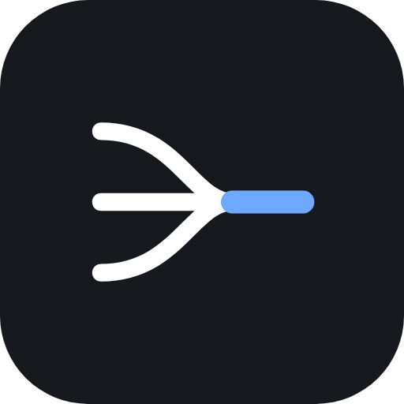
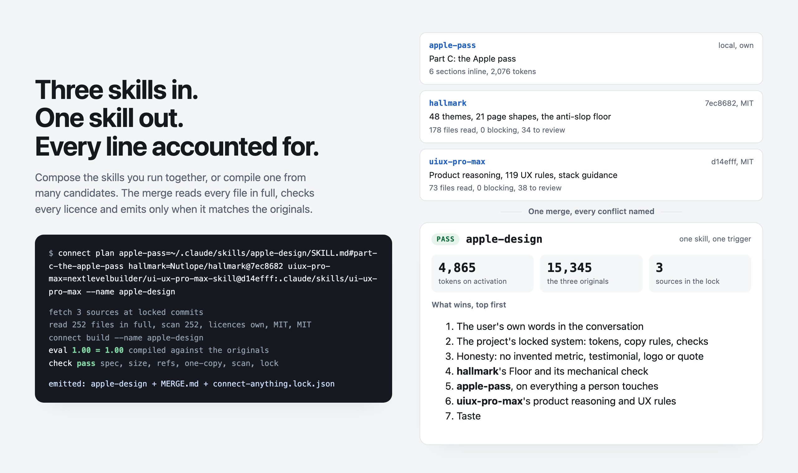

<div align="center">



# Connect Anything

**Give it the skills you run together, or a pile of candidates, and get one skill that reads every source in full, names every conflict and its winner, and ships only when it matches the originals.**

[](https://github.com/IndusCore-AI/connect-anything/actions/workflows/validate.yml)


[](LICENSE)

Claude Code · Codex CLI · Cursor · GitHub Copilot · claude.ai

[Quick start](#quick-start) · [Three entrances](#three-entrances-one-engine) · [Examples](#examples) · [How it works](#how-it-works) · [Install](#install) · [Safety](#what-it-refuses)



</div>

## Why

You already run two or three skills for one job. Each one asks to be invoked, loads its own context, and repeats rules the others also have. Combining them by hand loses the reasons, the licences and the conflicts.

Connect Anything does the merge as a build with evidence:

- **Every file is read in full.** Side files a SKILL.md never mentions included, with a hash of each.
- **Every conflict is named.** `MERGE.md` shows what one source says, what the other says, which one wins at this job and why.
- **Every line has a way home.** `connect-anything.lock.json` records each source's commit, licence, read count, scan result and kept files.
- **A merge that loses is refused.** The eval gate runs on every build; the compiled skill is written only when it matches or beats running the originals.
- **The sources are never trusted.** Read as data, scanned line by line, never executed. Download-and-run, secret reads, hidden text, prompt injection and forced promotion are excluded and named.
- **No model call without a budget.** The static tier is free and runs every time; the live tier needs `--max-cost-usd`.

## Quick start

```bash
npx skills add IndusCore-AI/connect-anything
```

Then ask in the way you would ask a person:

```text
connect apple-design and dashboard-design into one skill for review work
compile one research skill from this skill-radar report
my apple-design skill is weak on app screens, update it
```

Give it an eval file and it will also tell you whether the merge is as good as the originals:

```bash
python3 -I skills/connect-skills/scripts/connect plan \
  hallmark=Nutlope/hallmark@7ec8682 \
  uiux-pro-max=nextlevelbuilder/ui-ux-pro-max-skill@d14efff:.claude/skills/ui-ux-pro-max \
  --name my-design --job "Design and review screens" --evals my-evals.json
python3 -I skills/connect-skills/scripts/connect build --name my-design
```

## Three entrances, one engine

| Skill | Give it | Get |
| --- | --- | --- |
| `connect-skills` | the two or three skills you run together for one job (installed folders or GitHub URLs) | one skill for that job; the originals stay installed |
| `compile-skills` | 5 to 20 candidates (a skill-radar report, an awesome list, a search) and a profile of what you care about | one skill made of only the parts that fit |
| `update-skills` | a skill you already use, and a gap you name ("app screens") | upstream changes re-read and re-scanned, candidates that fill the gap, the eval re-run, and nothing written until you approve |

Each folder carries its own copy of the engine, so one skill installs on its own. `tools/sync.py` keeps the copies identical.

## Examples

Every example is a real run against named commits, with the compiler-written files committed so you can read the result.

<table>
  <tr>
    <td width="33%"><a href="examples/apple-design"></a></td>
    <td width="33%"><a href="examples/apple-design"></a></td>
    <td width="33%"><a href="examples/refusals"></a></td>
  </tr>
  <tr>
    <td><b>Name the conflict</b><br><sub><code>MERGE.md</code> shows both sides, the winner and the reason.</sub></td>
    <td><b>Show the provenance</b><br><sub>One lockfile: commits, licences, reads, scans, kept files.</sub></td>
    <td><b>Refuse a loss</b><br><sub>A merge that drops an eval never reaches <code>--out</code>.</sub></td>
  </tr>
</table>

- [`examples/apple-design`](examples/apple-design): recreates a hand-made design skill from Hallmark, UI UX Pro Max and the author's own Apple pass. Its `MERGE.md` explains, section by section, how it differs from the hand-made one. 4,865 tokens on activation instead of 15,345 for the three originals.
- [`examples/research-compile`](examples/research-compile): a research-brief skill compiled from five candidates in a skill-radar report. It excludes the sub-skills that need a paid API, meets CC BY duties for one source and adapts two sections with the changes recorded.
- [`examples/update-app-screens`](examples/update-app-screens): an update run that adopts a lock for the hand-made skill, keeps its local edits, finds the gap ("app screens"), names an unlicensed candidate instead of copying it, and proposes a patch. Nothing is applied without its approval id.
- [`examples/refusals`](examples/refusals): two unlicensed skills named, never copied; a real promotional sign-off and a hidden download-and-run step excluded and named; a merge that loses an eval, refused with its scores.

Rebuild them all with `python3 examples/build.py`. The tests rebuild them in a scratch folder so the committed outputs stay as they are.

## How it works

```text
sources ──▶ fetch at a locked commit ──▶ read every file in full ──▶ scan every line
                                                                        │
                       ┌────────────────────────────────────────────────┘
                       ▼
                 licence check ──▶ choose parts against the job ──▶ merge
                                                                     │
              SKILL.md · MERGE.md · a folder per source · lockfile  │
                                                                     ▼
                                                     checks ──▶ eval gate ──▶ emit or refuse
```

1. **Fetch** each source at a commit (GitHub, a local folder, or one skill inside a monorepo).
2. **Read** every file, including the ones no SKILL.md mentions. A file counts as read only when the bytes read equal its size.
3. **Scan** every line with our patterns and skill-radar's, after normalising away the tricks: tag characters, stray variation selectors, odd spaces, line wraps, look-alike letters, base64 blobs and two-step downloads.
4. **Check the licence.** MIT, BSD, ISC, Apache-2.0, CC-BY-4.0, CC0 and Unlicense can be copied. No licence, NonCommercial, NoDerivatives and proprietary terms are named and never copied. Copyleft is named by default.
5. **Choose** what fits the job. The agent writes its judgement to `decisions.json`; the engine re-applies it on every build, so `update` can carry the same judgement to new commits.
6. **Merge** one `SKILL.md` with a "what wins, top first" list, a folder per source with its README, LICENSE and commit, `MERGE.md` and `connect-anything.lock.json`.
7. **Check and gate.** Spec, size, references, one copy per rule, no nested skill, provenance, scan and lock hash; then the eval, static on every build and live only with a budget. A refusal writes `REFUSED.md` and the scoreboard to the work folder, not `--out`.

## Install

<details open>
<summary><b>Any agent that reads Agent Skills</b> (Claude Code, Codex, Cursor and others)</summary>

```bash
npx skills add IndusCore-AI/connect-anything
```
</details>

<details>
<summary><b>Claude Code, as a plugin</b></summary>

```text
/plugin marketplace add IndusCore-AI/connect-anything
/plugin install connect-anything@induscore
```

The plugin gives you `/connect-anything:connect-skills`, `compile-skills` and `update-skills`.
</details>

<details>
<summary><b>GitHub Copilot, Codex and others, with GitHub CLI</b></summary>

```bash
gh skill install IndusCore-AI/connect-anything connect-skills
gh skill install IndusCore-AI/connect-anything compile-skills
gh skill install IndusCore-AI/connect-anything update-skills
```
</details>

<details>
<summary><b>By hand</b></summary>

```bash
git clone https://github.com/IndusCore-AI/connect-anything
cp -R connect-anything/skills/connect-skills ~/.claude/skills/
```

Copy the other two folders the same way, or all three for the full set.
</details>

It needs Python 3.9 or later and `git`, and nothing else: no packages, no network at run time except the fetch. `gh` is used when present, for private repos and commit lookups.

## What it refuses

- **Unlicensed sources.** A skill with no licence, or one that forbids derivatives, is named and left for you to install. It is never copied.
- **Code that runs.** Sources are read as data. A file that downloads and runs code, reads secrets, hides instructions or makes the agent advertise someone is excluded and named, never executed.
- **A merge that loses.** If the compiled skill scores below the originals, nothing is written to `--out`. The scores and the reasons go to `REFUSED.md`.
- **A lock that points outside.** A skill folder can arrive from anywhere, so its lock is untrusted: names, folders and paths are validated before `update` joins them to a real path.
- **A model call without a budget.** The static tier is free; a live run needs `--max-cost-usd` agreed first. A dry run plans the calls and costs nothing.

## Tests

```bash
python3 tests/run.py            # offline: 57 tests, no network, no model calls
python3 tests/run.py --online   # adds the six acceptance tests against the real sources
python3 tools/sync.py --check   # the three skill folders match scripts/ and references/
```

The offline suite covers the engine, the scanner, the licence rules, the eval gate, the lockfile, update and the
refusals. The online suite fetches the real sources, recreates the examples and checks the emitted skills pass
`skills-ref validate` when it is installed. CI runs the offline suite on Python 3.9 and 3.12, the sync check and
`skills-ref validate` on the three skill folders.

## Credits

The eval file is Anthropic skill-creator's `evals/evals.json` format (Apache-2.0, https://github.com/anthropics/skills), with two fields added. The lockfile's source entries follow the `skills` CLI's `skills-lock.json` (vercel-labs/skills) and compute `computedHash` the same way. Skills follow the Agent Skills specification (https://agentskills.io/specification). The scanner starts from skill-radar's pattern list.

MIT, copyright IndusCore. See [LICENSE](LICENSE). Decisions and their evidence: [DECISIONS.md](DECISIONS.md). Changes: [CHANGELOG.md](CHANGELOG.md).

Built by IndusCore, [induscore.site](https://induscore.site).
