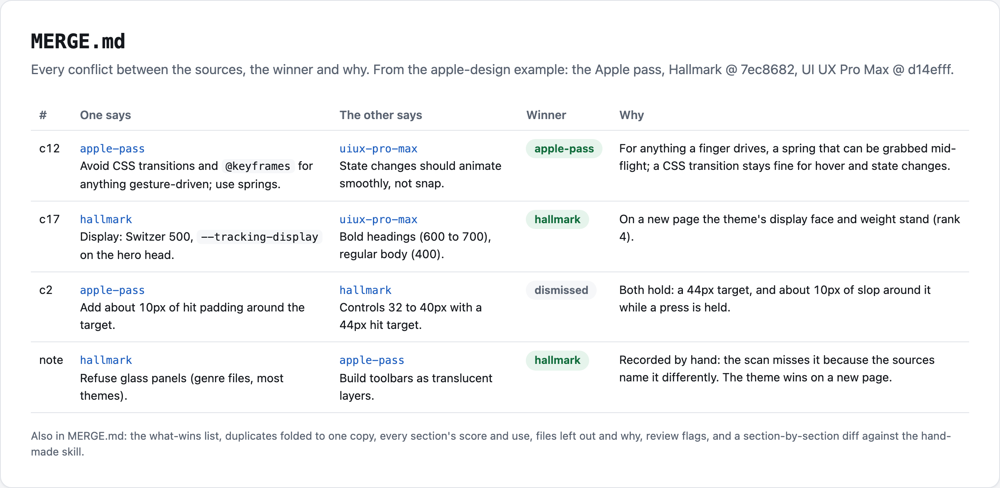
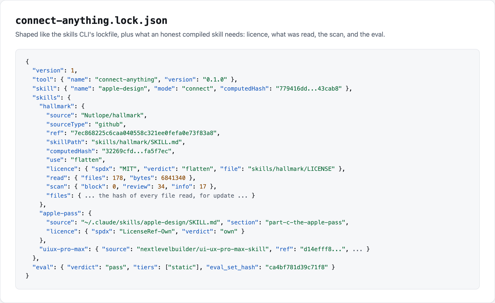
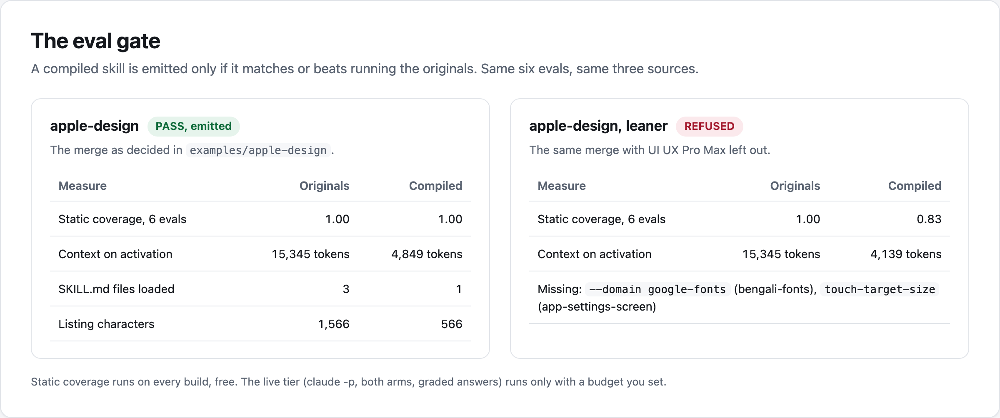

# connect-anything

Give it the skills you use together, or a pile of candidates from the field, and get one skill that reads every source in full, keeps a lockfile of where each part came from, names every conflict and its winner, and is emitted only when it matches or beats running the originals.







## Install

| Agent | Command |
| --- | --- |
| Claude Code (plugin) | `/plugin marketplace add gaurpulkit/connect-anything`, then `/plugin install connect-anything@induscore` |
| Any agent, with the skills CLI | `npx skills add gaurpulkit/connect-anything` |
| GitHub Copilot, Codex and others, with GitHub CLI | `gh skill install gaurpulkit/connect-anything connect-skills` (and `compile-skills`, `update-skills`) |
| By hand | copy `skills/connect-skills` (and the others) into `~/.claude/skills/` or your agent's skills folder |

Needs Python 3.9 or later and `git`. `gh` is used when present, for private repos and commit lookups. No other dependency.

## Three entrances, one engine

| Skill | Give it | Get |
| --- | --- | --- |
| `connect-skills` | the two or three skills you run together for one job (installed folders or GitHub URLs) | one skill for that job; the originals stay installed |
| `compile-skills` | 5 to 20 candidates (a skill-radar report, an awesome list, a search) and a profile of what you care about | one skill made of only the parts that fit |
| `update-skills` | a skill you already use, and a gap you name ("app screens") | upstream changes re-read and re-scanned, candidates that fill the gap, the eval re-run, and nothing written until you approve |

Every run does the same steps: fetch each source at a locked commit; read every file in full; scan every line, secondary files included; check the licence; choose parts against the job; write one SKILL.md with a "what wins, top first" list, a folder per source with its README, LICENSE and commit, `MERGE.md` and `connect-anything.lock.json`; run the checks; run the eval gate. The agent makes the judgement calls in a `decisions.json` the engine re-applies on every build, so `update` can apply the same judgement to new commits.

```bash
python3 -I skills/connect-skills/scripts/connect plan \
  hallmark=Nutlope/hallmark@7ec8682 \
  uiux-pro-max=nextlevelbuilder/ui-ux-pro-max-skill@d14efff:.claude/skills/ui-ux-pro-max \
  --name my-design --job "Design and review screens" --evals my-evals.json
python3 -I skills/connect-skills/scripts/connect build --name my-design
```

## Examples

- [`examples/apple-design`](examples/apple-design): recreates a hand-made design skill from Hallmark, UI UX Pro Max and the author's own Apple pass. Its `MERGE.md` explains, section by section, how it differs from the hand-made one. 4,849 tokens on activation instead of 15,345 for the three originals.
- [`examples/research-compile`](examples/research-compile): a research-brief skill compiled from five candidates in a skill-radar report. It excludes the sub-skills that need a paid API, meets CC BY duties for one source and adapts two sections with the changes recorded.
- [`examples/update-app-screens`](examples/update-app-screens): an update run that adopts a lock for the hand-made skill, keeps its local edits, finds the gap ("app screens"), names an unlicensed candidate instead of copying it, and proposes a patch.
- [`examples/refusals`](examples/refusals): two unlicensed skills named, never copied; a real promotional sign-off and a hidden download-and-run step excluded and named; a merge that loses an eval, refused with its scores.

Rebuild them all with `python3 examples/build.py`.

## What it does not do

- **It does not install skills for you.** It writes a folder; you put it where your agent reads skills.
- **It does not judge taste.** It finds candidate conflicts and checks coverage; the agent and you decide, and every decision is written down with its reason.
- **It refuses unlicensed sources.** A skill with no licence, or one that forbids derivatives, is named and left for you to install, never copied. Copyleft is named by default too.
- **It does not run anything it fetched.** Sources are read as data. A source whose files try to download and run code, read secrets, hide text, inject instructions or make the agent advertise someone is excluded and named.
- **It does not call a model unless you give it a budget.** The static eval runs on every build for free; the live eval runs only with `--max-cost-usd`.

## Tests

```bash
python3 tests/run.py            # offline: 45 tests, no network, no model calls
python3 tests/run.py --online   # adds the six acceptance tests against the real sources
```

## Credits

The eval file is Anthropic skill-creator's `evals/evals.json` format (Apache-2.0, https://github.com/anthropics/skills), with two fields added. The lockfile's source entries follow the `skills` CLI's `skills-lock.json` (vercel-labs/skills) and compute `computedHash` the same way. Skills follow the Agent Skills specification (https://agentskills.io/specification) and pass `skills-ref validate`. The scanner starts from skill-radar's pattern list.

   

MIT. See [LICENSE](LICENSE). Decisions and their evidence: [DECISIONS.md](DECISIONS.md). Changes: [CHANGELOG.md](CHANGELOG.md).

Built by IndusCore, [induscore.site](https://induscore.site).
